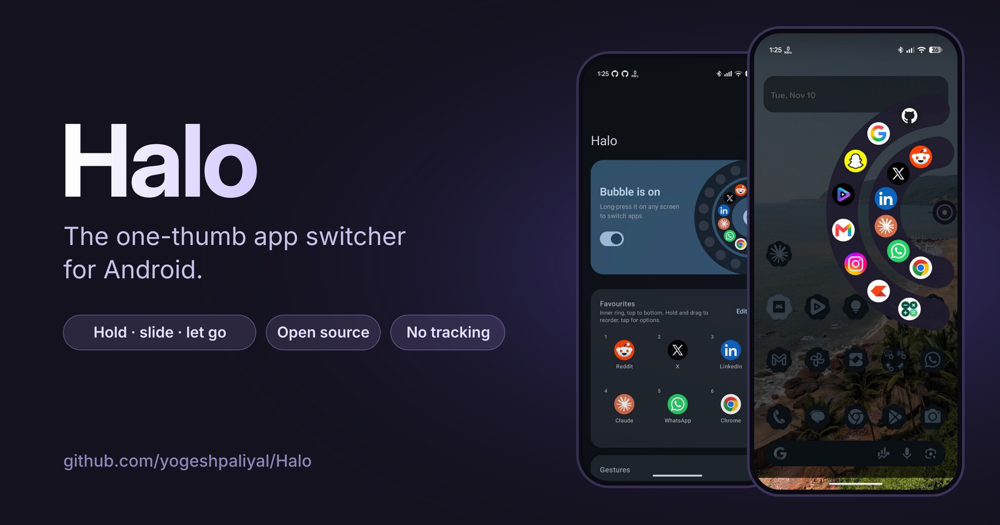
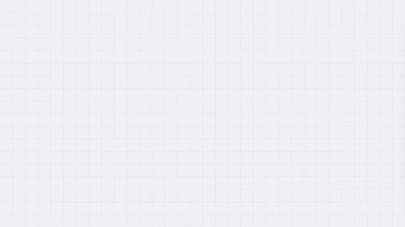
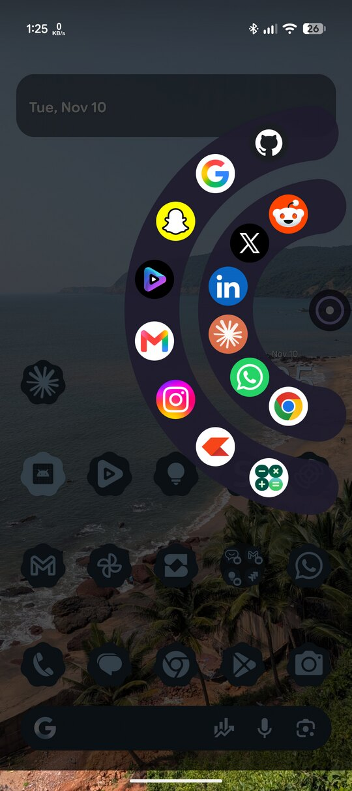
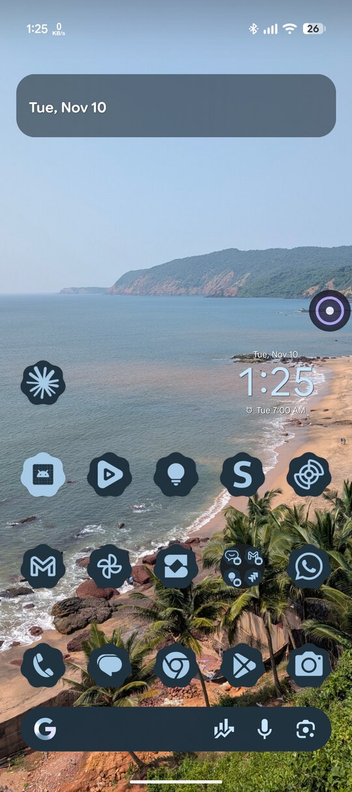
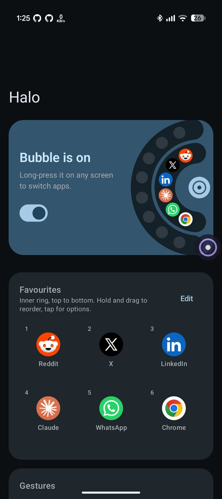
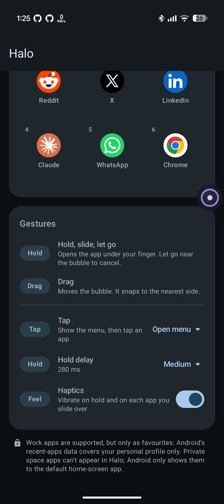

<p align="center"></p>

<h1 align="center">Halo: One-Thumb App Switcher</h1>

<p align="center"><b>Hold the edge bubble, slide to an app, let go.</b><br>
Switch between your apps with one thumb, without opening the recents screen.</p>

<p align="center">
  <a href="https://play.google.com/store/apps/details?id=com.yogeshpaliyal.halo"></a>
</p>

<p align="center">
  <a href="https://github.com/yogeshpaliyal/Halo/releases/latest"></a>
  
  
  
  <a href="LICENSE"></a>
</p>

---

## What is Halo?

Halo puts a small bubble on the edge of your screen. **Hold it** and a half-circle menu opens with your
favourite apps on the inside and your recent apps on the outside. **Slide** your thumb to an app and
**let go** to open it. That's the whole gesture.

It's for anyone who bounces between the same few apps all day (chat, maps, music, the browser) and
is tired of the full-screen recents detour. It works on any Android phone from Android 8.0 on, and is
especially handy on phones without a built-in edge panel, like Pixels.

<p align="center"></p>

**Free, no ads, no account, and no internet permission**, so Halo can't send anything off your phone.

## Get Halo

<a href="https://play.google.com/store/apps/details?id=com.yogeshpaliyal.halo"></a>
<a href="https://yogeshpaliyal.github.io/Halo/obtainium/"></a>
<a href="https://github.com/yogeshpaliyal/Halo/releases/latest"></a>

1. **[Google Play](https://play.google.com/store/apps/details?id=com.yogeshpaliyal.halo)** is the easiest
   way. It updates automatically, and the "restricted setting" step below doesn't apply.
2. **[Obtainium](https://github.com/ImranR98/Obtainium)** if you prefer installing APKs: tap the badge on
   your phone, then **Add to Obtainium**. It installs the latest signed release and keeps it updated.
3. **GitHub**: download `halo-vX.Y.Z.apk` from the
   [latest release](https://github.com/yogeshpaliyal/Halo/releases/latest).

All three are the same app, signed with the same key.

### First run

1. Open Halo and allow **Display over other apps** (this draws the bubble).
2. Optionally allow **Usage access** so the outer ring can show your recent apps.
3. Pick up to six favourites and turn on **Floating bubble**. Done.

## What you can do with it

**Switch apps in one move**
- Hold the bubble: favourites on the inner ring, recent apps on the outer ring.
- Slide to an app (you feel a small tick on each one) and let go to open it. Let go near the bubble to cancel.
- Tap the bubble to jump back to the app you just left. Double-tap for the one before that.

**Quick controls on the dial**
- Brightness and volume sliders wrap around the outside of the menu. Slide onto one and move along it.
- Add a flashlight, volume panel or play/pause button as a favourite.
- Group up to 8 apps in a folder that fans out when you rest on it.

**Make it yours**
- 7 bubble characters (Classic, Blob, Kitty, Ghost, Sprout, Star, Bot) in 8 colours. They blink, look
  around and react when you touch them.
- Small, medium or large bubble, with adjustable opacity. Drag it anywhere; it snaps to the nearest edge. Optionally tuck it half into the edge, so it slides out only when you touch it.
- Choose what a tap and double-tap do, how long to hold, and whether it vibrates.
- Themed (single-colour) icons that match your wallpaper.

**Stays out of your way**
- Hides itself in full-screen games and videos, and in any apps you choose.
- Turn the recent-apps ring off for a favourites-only dial, or keep any app out of it.
- Optional dots on apps with unread notifications.
- Comes back on its own after you restart your phone.
- Work profile apps can be favourites.
- Available in 11 languages: English, Deutsch, Español, Français, हिन्दी, Bahasa Indonesia, Italiano,
  日本語, Português (Brasil), Русский and Türkçe.

## Screenshots

<table>
  <tr>
    <td align="center"><br><sub>Hold, slide, let go</sub></td>
    <td align="center"><br><sub>Stays out of the way</sub></td>
    <td align="center"><br><sub>Pick up to six favourites</sub></td>
    <td align="center"><br><sub>Tune the gestures</sub></td>
  </tr>
</table>

## Private by design

- **No internet permission.** Android won't let Halo connect to the internet, so nothing can leave your phone.
- **No ads, no analytics, no account.**
- **No Accessibility access needed.** Many app switchers ask for it; Halo doesn't.
- **Open source.** Every line of code is in this repository. Read the [privacy policy](PRIVACY.md).

## Questions

<details>
<summary><b>Why does Halo need these permissions?</b></summary>

| Permission | Why | Required? |
|---|---|---|
| Display over other apps | Draws the bubble and the menu on top of other apps | Yes |
| Usage access | Finds your recently used apps for the outer ring | No: without it you get favourites only |
| Notifications (Android 13+) | A silent notification that keeps the bubble running, with a Stop button | Recommended |
| Modify system settings | Lets the brightness slider change your screen brightness | No: only asked when you first use it |
| Notification access | Shows a dot on apps with unread notifications. Halo sees which apps, never what the notifications say | No: off unless you turn on notification dots |
| Run at startup | Brings the bubble back after a restart, if it was on | Automatic |

None of these let Halo send data anywhere, because it has no internet permission.
</details>

<details>
<summary><b>Android says "Restricted setting" or the switch is greyed out</b></summary>

This only happens if you installed the APK from GitHub or Obtainium, not from Google Play. Android 15
and later block *Display over other apps* and *Usage access* for downloaded apps until you allow them:

1. Open **Settings → Apps → Halo**.
2. Tap **⋮** (top right) and choose **Allow restricted settings**.
3. Confirm with your screen lock, then go back to Halo and grant the permission again.

Halo's setup card has an **Open App info** shortcut that takes you straight there.
</details>

<details>
<summary><b>Is it really free?</b></summary>

Yes. No ads, no in-app purchases, no subscription. Halo is open source under the MIT license.
</details>

<details>
<summary><b>Which phones does it work on?</b></summary>

Any Android phone running Android 8.0 or later. It's a regular app, so it doesn't depend on your phone brand or launcher.
</details>

<details>
<summary><b>Why don't my Private space apps show up?</b></summary>

Android only shows Private space apps to the default home-screen app, so no other app, Halo included,
can list or open them. Work profile apps work fine and show a briefcase badge.
</details>

<details>
<summary><b>How do I turn it off?</b></summary>

Tap **Stop** on Halo's notification, or switch off **Floating bubble** in the app.
</details>

Something else? Ask in [Q&A](https://github.com/yogeshpaliyal/Halo/discussions/categories/q-a) or
[report a bug](https://github.com/yogeshpaliyal/Halo/issues).

## Why I built this

I switch between the same handful of apps all day, and the recents screen is a slow way to do it: a
full-screen detour every time. I wanted a small button on the edge of the screen that I could hold, slide
to an app, and let go.

Pixel phones don't have an edge panel, and the apps I tried for this were closed source, looked dated, or
asked for Accessibility access. That's a lot of trust to give an app I can't read. So I built Halo to do
this one thing: open source, no internet permission, nothing collected.

It's written in Kotlin and Jetpack Compose, with Claude as a pair programmer. I review the changes and use
it every day.

## Featured

Videos, posts and write-ups about Halo. Thank you!

<a href="https://youtu.be/Lzc-hnSZY08?t=63"></a>

- [Halo on YouTube](https://youtu.be/Lzc-hnSZY08?t=63) (Halo from 1:03)

Made a video, blog post or thread about Halo? Share it in [Discussions](https://github.com/yogeshpaliyal/Halo/discussions) and it'll be added here.

## Community

- **Show your setup:** post your recap card or bubble style in [Discussions → Show your setup](https://github.com/yogeshpaliyal/Halo/discussions/categories/show-your-setup), or share it anywhere with **#HaloRecap**.
- **Ideas and questions:** [Ideas](https://github.com/yogeshpaliyal/Halo/discussions/categories/ideas) and [Q&A](https://github.com/yogeshpaliyal/Halo/discussions/categories/q-a).
- **Bugs:** [open an issue](https://github.com/yogeshpaliyal/Halo/issues).
- **Like Halo?** A ⭐ on this repo or a review on [Google Play](https://play.google.com/store/apps/details?id=com.yogeshpaliyal.halo) helps other people find it.

---

## For developers

<details>
<summary><b>Build from source</b></summary>

Open the project in Android Studio, or run:

```
./gradlew installDebug
```

Then grant the permissions and pick favourites as described in [First run](#first-run).
</details>

<details>
<summary><b>How it works</b></summary>

| Piece | File |
|---|---|
| Foreground service that owns the overlay windows | `overlay/HaloService.kt` |
| Bubble: tap / drag / long-press gesture state machine | `overlay/BubbleView.kt` |
| Radial menu drawing and hit-testing | `overlay/RadialMenuView.kt` |
| Installed apps, favourites, recents (`UsageStatsManager` events), launching | `data/AppRepository.kt` |
| Settings screen (Compose) | `ui/MainActivity.kt` |

The long-press → slide → release gesture works because Android keeps delivering the whole touch stream to the window that got `ACTION_DOWN` (the small bubble window). The menu itself is a separate full-screen, **non-touchable** overlay that just draws what the bubble reports.
</details>

<details>
<summary><b>Verify the APK</b></summary>

Every release APK, and the Play Store version, is signed with the same key. Its certificate SHA-256 is:

```
com.yogeshpaliyal.halo
4D:C1:4F:08:7E:D5:AB:99:63:D1:C1:EF:11:15:EC:3B:33:1E:4B:BD:A5:85:8A:0C:FF:7F:A2:66:73:4A:CD:E5
```

Check it with [AppVerifier](https://github.com/soupslurpr/AppVerifier) (paste both lines) or
`apksigner verify --print-certs halo-vX.Y.Z.apk`. Each release also lists SHA-256 checksums of its files.
</details>

<details>
<summary><b>Debug builds</b></summary>

Every push to `main` builds a debug APK and publishes it to the
[**Latest master**](https://github.com/yogeshpaliyal/Halo/releases/tag/latest-master) pre-release:
**[halo-debug.apk](https://github.com/yogeshpaliyal/Halo/releases/download/latest-master/halo-debug.apk)**.

They install as **Halo Debug** (`com.yogeshpaliyal.halo.debug`, amber icon), next to the release version,
and are signed with the public `keystore/debug.keystore`, so their fingerprint won't match the one above.
Obtainium ignores this pre-release by default and tracks only signed releases.
</details>

<details>
<summary><b>Releasing</b></summary>

Actions → **Release** → **Run workflow**, then pick `patch`, `minor` or `major`. The workflow bumps
`versionName` and `versionCode` in `app/build.gradle.kts`, builds the signed APK and AAB, and only if
the build succeeds commits the bump to `main`, tags it (`vX.Y.Z`) and publishes a GitHub release with
both files attached and the signing fingerprint in the notes. Upload the `.aab` to Play Console.
</details>

<details>
<summary><b>Stats</b></summary>

Halo has no analytics in the app. Download counts, stars and repo traffic are collected from
GitHub's APIs by the `Stats snapshot` workflow (daily, and before each `latest-master` rebuild) and
saved to the [`stats` branch](https://github.com/yogeshpaliyal/Halo/tree/stats).

Repo views, clones and referrers need one extra step, because the Actions token can't read
GitHub's traffic API: create a fine-grained token for this repo with **Administration: Read-only**
and add it as the `TRAFFIC_TOKEN` repository secret.
</details>

The animation at the top is rendered from the real screenshots by [`docs/promo_video.py`](docs/promo_video.py)
(the `20-gesture` scene).

## License

Halo is released under the [MIT License](LICENSE).

Copyright (c) 2026 Yogesh Paliyal

You can use, copy, modify and distribute it, including in commercial projects, as long as the copyright notice and
license text are kept with any copy.

### Third-party

- The quick-action icons (flashlight, volume, play/pause) are adapted from Google's
  [Material Icons](https://github.com/google/material-design-icons), licensed under the
  [Apache License 2.0](https://www.apache.org/licenses/LICENSE-2.0).
- App icons shown in screenshots and promotional images belong to their respective owners and appear only to show
  Halo in use.
