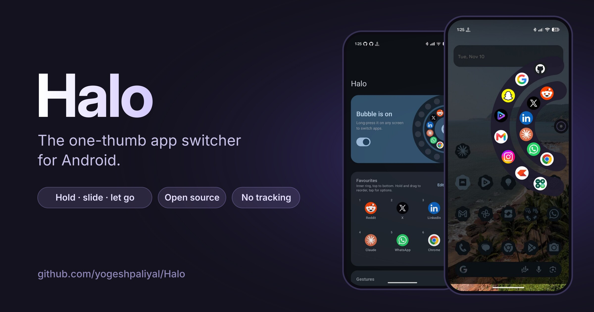
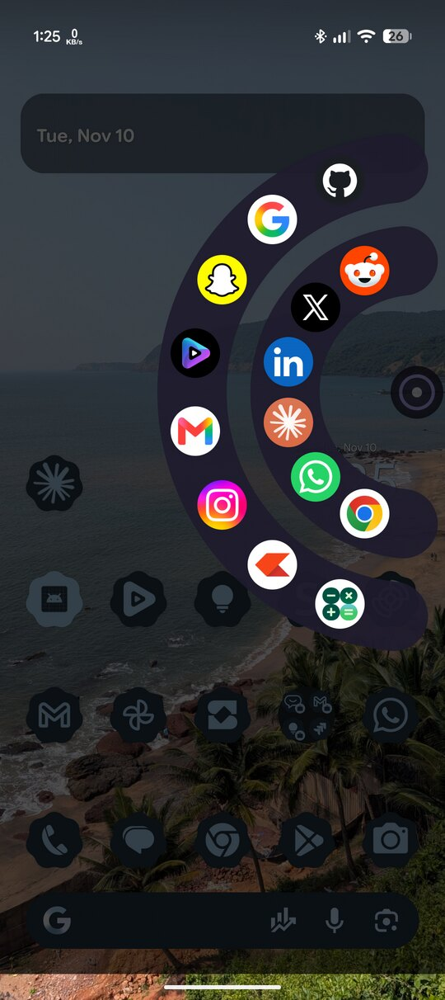
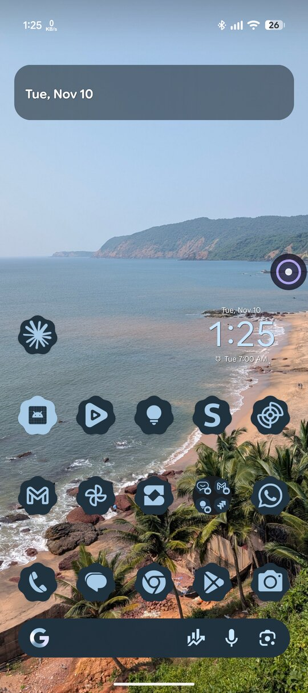
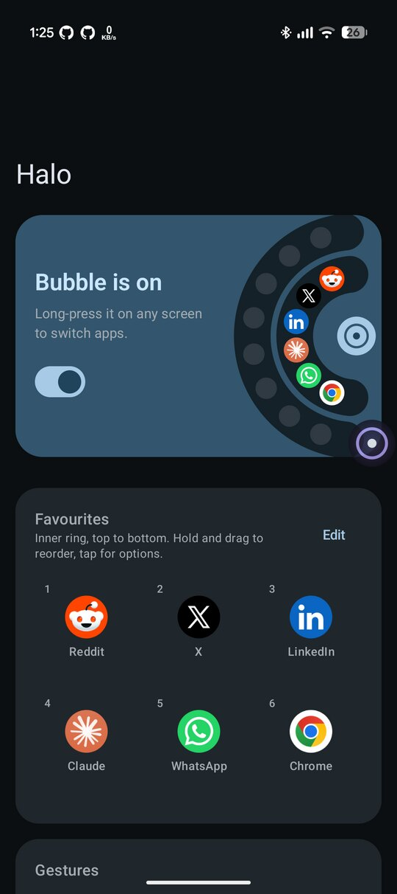
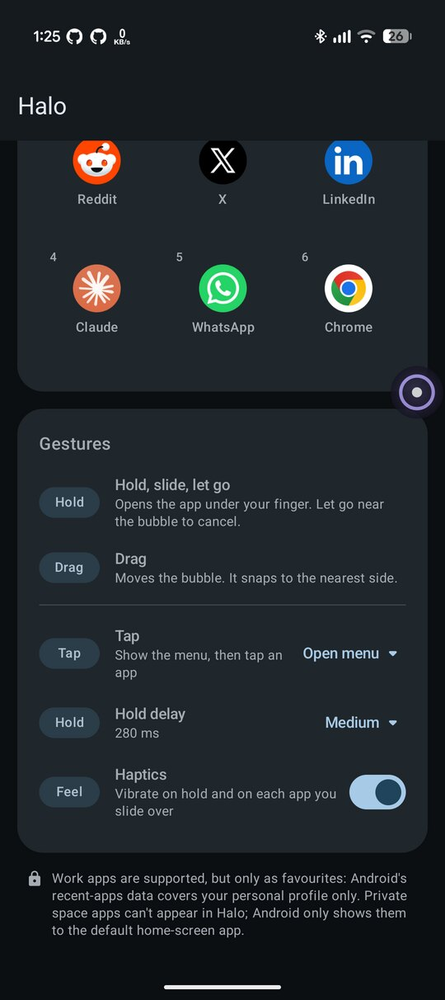

# Halo

A floating bubble that sticks to the edge of your screen and lets you switch apps with one thumb.

- **Long-press** the bubble → a radial menu opens: your **favourites** on the inner ring, **recent apps** on the outer ring.
- **Slide** to an app (you feel a tick on each one), **let go** to open it. Let go near the bubble to cancel.
- **Tap** the bubble to jump back to your previous app (or set it to open the menu, or do nothing).
- **Drag** the bubble anywhere; it snaps to the nearest side and remembers its position.
- **Configurable**: tap action, hold delay (200 / 280 / 400 ms) and haptics.

- **Work profile** apps can be favourites (shown with the briefcase badge). Private space apps can't: Android only exposes them to the default home app.

No ads, no tracking, no internet permission.

## Screenshots

<table>
  <tr>
    <td align="center"> Hold, slide, let go</td>
    <td align="center"> Stays out of the way</td>
    <td align="center"> Pick up to six favourites</td>
    <td align="center"> Tune the gestures</td>
  </tr>
</table>

## Download

Every push to the default branch builds a debug APK and publishes it to the
[**Latest master**](https://github.com/yogeshpaliyal/Halo/releases/tag/latest-master) release:

**[halo-debug.apk](https://github.com/yogeshpaliyal/Halo/releases/download/latest-master/halo-debug.apk)**

Builds are signed with the committed `keystore/debug.keystore` (password `android`), so each new
build installs over the previous one.

## Stats

Halo has no analytics in the app. Download counts, stars and repo traffic are collected from
GitHub's APIs by the `Stats snapshot` workflow (daily, and before each `latest-master` rebuild) and
saved to the [`stats` branch](https://github.com/yogeshpaliyal/Halo/tree/stats).

Repo views, clones and referrers need one extra step, because the Actions token can't read
GitHub's traffic API: create a fine-grained token for this repo with **Administration: Read-only**
and add it as the `TRAFFIC_TOKEN` repository secret.

## Setup

1. Open the project in Android Studio (or run `./gradlew installDebug`), or install the APK above.
2. In the app, grant:
   - **Display over other apps**: draws the bubble.
   - **Usage access**: powers the recent-apps ring. Optional; without it you only get favourites.
   - **Notifications** (Android 13+): a silent notification with a Stop button.
3. Pick up to 6 favourites and turn on **Floating bubble**.

> **“Restricted setting” or a greyed-out switch?** Android 15+ blocks *Display over other apps* and
> *Usage access* for apps installed from a downloaded APK. Open **Settings → Apps → Halo**, tap **⋮**
> (top right), choose **Allow restricted settings**, confirm with your screen lock, then grant the
> permission again. Halo's setup card has an **Open App info** shortcut for this.

## How it works

| Piece | File |
|---|---|
| Foreground service that owns the overlay windows | `overlay/HaloService.kt` |
| Bubble: tap / drag / long-press gesture state machine | `overlay/BubbleView.kt` |
| Radial menu drawing and hit-testing | `overlay/RadialMenuView.kt` |
| Installed apps, favourites, recents (`UsageStatsManager` events), launching | `data/AppRepository.kt` |
| Settings screen (Compose) | `ui/MainActivity.kt` |

The long-press → slide → release gesture works because Android keeps delivering the whole touch stream to the window that got `ACTION_DOWN` (the small bubble window). The menu itself is a separate full-screen, **non-touchable** overlay that just draws what the bubble reports.

## Roadmap ideas

- Start on boot
- Hide automatically in full-screen apps / games
- Bubble size, opacity and long-press delay settings
- Reorder favourites by drag
- App shortcuts (long-press shortcuts) as a third ring

## Privacy

Halo collects no data and has no internet permission. Read the [privacy policy](PRIVACY.md).

## License

MIT
